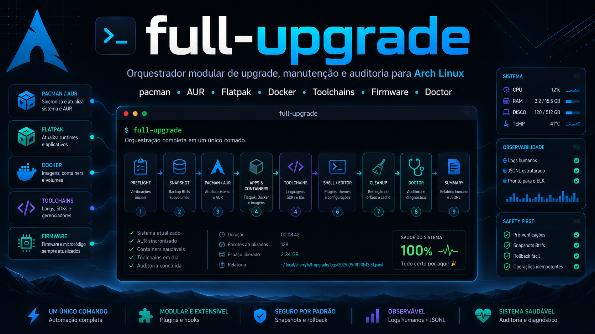

<!-- markdownlint-disable MD013 MD033 MD041 -->

<div align="center">



<br>

<a href="https://github.com/bernardopg/full-upgrade/releases/latest"></a>
<a href="https://aur.archlinux.org/packages/full-upgrade"></a>
<a href="https://github.com/bernardopg/full-upgrade/actions/workflows/ci.yml"></a>
<a href="https://codecov.io/gh/bernardopg/full-upgrade"></a>
<a href="https://scorecard.dev/viewer/?uri=github.com/bernardopg/full-upgrade"></a>
<a href="https://www.bestpractices.dev/projects/13424"></a>
<a href="LICENSE"></a>

<p>
  <b>Um comando para manter um Arch Linux inteiro em dia.</b><br>
  Sistema, AUR, containers, toolchains, CLIs de IA, firmware e plugins —
  com auditoria de saúde, logs rastreáveis e um resumo do que precisa da sua atenção.
</p>

<a href="docs/installation.md"><b>Instalação</b></a> ·
<a href="docs/usage.md"><b>Uso</b></a> ·
<a href="docs/configuration.md"><b>Configuração</b></a> ·
<a href="docs/README.md"><b>Documentação</b></a> ·
<a href="CONTRIBUTING.md"><b>Contribuir</b></a>

</div>

---

## Por quê

Uma estação Arch moderna tem muitas camadas que se atualizam cada uma do seu
jeito: pacman, AUR, Flatpak, Docker, npm, pip, cargo, Go, CLIs de IA, plugins do
editor e do shell, firmware. O `full-upgrade` reúne tudo num fluxo único,
declarado e seguro: cada passo é um step com timeout, dependências e motivo
registrado, e o run termina com um resumo que separa o que atualizou do que
falhou, do que é só aviso e do que exige ação sua.

## Destaques

- **Cobertura ampla, por presença:** mais de 175 steps em 19 categorias.
  Ferramenta ausente vira `skip` com o motivo; nada quebra o fluxo.
- **Também o que nenhum gerenciador atualiza:** binários baixados à mão
  (CLIProxyAPI, Proton-GE, Nerd Fonts, AppImages), extensões e plugins (gh,
  krew, Helm, tmux, fish, zinit, treesitter), bases de segurança (ClamAV,
  nuclei, Exploit-DB, rkhunter) e toolchains (mise, juliaup, elan, SDKMAN!).
- **Seguro por construção:** lock anti-concorrência, snapshot pré-upgrade,
  backup de `/etc`, timeouts por step, `--dry-run` e um `--mode doctor`
  garantidamente read-only.
- **Resiliente:** rede instável vira aviso em vez de falha, e condição
  permanente vira pendência com remediação, nunca `fail` eterno.
- **Doctor:** 29 auditorias read-only (reboot pendente, units falhadas, journal,
  crashes recorrentes, SMART, btrfs, CVEs, firmware, MCP…).
- **Rastreável:** log humano e JSONL por run, relatório Markdown, histórico com
  tendência e saída JSON para automação.
- **Integrado ao desktop:** applet de bandeja com estado, lista de atualizações e
  ações, e um TUI de configuração em Bash puro.

## Instalação

```bash
paru -S full-upgrade        # AUR (recomendado)
```

Ou, em qualquer distro com Bash 4.3+:

```bash
git clone https://github.com/bernardopg/full-upgrade && cd full-upgrade && ./install.sh
```

Detalhes, standalone e verificação de integridade em
[Instalação e atualização](docs/installation.md).

## Uso

```bash
full-upgrade                 # fluxo completo
full-upgrade --dry-run       # ver o plano sem mudar nada
full-upgrade --mode doctor   # só auditorias (read-only)
full-upgrade --only ai       # só uma categoria, tag ou step
full-upgrade --resume        # repetir só o que não fechou ok no último run
full-upgrade --config-tui    # configurar pelo TUI
full-upgrade --tray --enable # applet de bandeja no login
```

```text
Resumo
  Sistema / Pacotes (27s)
    ✔  Atualizar pacotes do sistema e AUR        (8s)
    ✔  Atualizar imagens Docker                  (12s)
  …
  Total: 134 ok, 0 warn, 0 todo, 0 fail, 18 skip em 8m 42s
  Pacotes alterados (4 atualizado(s), 0 instalado(s), 0 removido(s))
```

Todos os comandos, modos, filtros e status em [Uso](docs/usage.md).

## Documentação

| Para quem usa | Para quem desenvolve |
| --- | --- |
| [Instalação e atualização](docs/installation.md) | [Arquitetura](docs/architecture.md) |
| [Uso](docs/usage.md) | [Salvaguardas](docs/safeguards.md) |
| [Steps e cobertura](docs/steps.md) | [Desenvolvimento](docs/development.md) |
| [Doctor e auditoria](docs/doctor.md) | [Contribuindo](CONTRIBUTING.md) |
| [Configuração](docs/configuration.md) | [Segurança](SECURITY.md) |
| [Systray](docs/tray.md) | [Changelog](CHANGELOG.md) |
| [Logs e relatórios](docs/logs-and-reports.md) | |
| [Solução de problemas](docs/troubleshooting.md) | |

## Apoie o projeto

Se o `full-upgrade` te poupa tempo, considere apoiar o desenvolvimento:

<a href="https://github.com/sponsors/bernardopg"></a>
<a href="https://ko-fi.com/bernardopg"></a>
<a href="https://www.buymeacoffee.com/wctwom9emu"></a>

## Licença

[MIT](LICENSE).

<div align="center">
<br>
<sub>Feito com ☕ e Bash por <a href="https://github.com/bernardopg">@bernardopg</a></sub>
</div>
